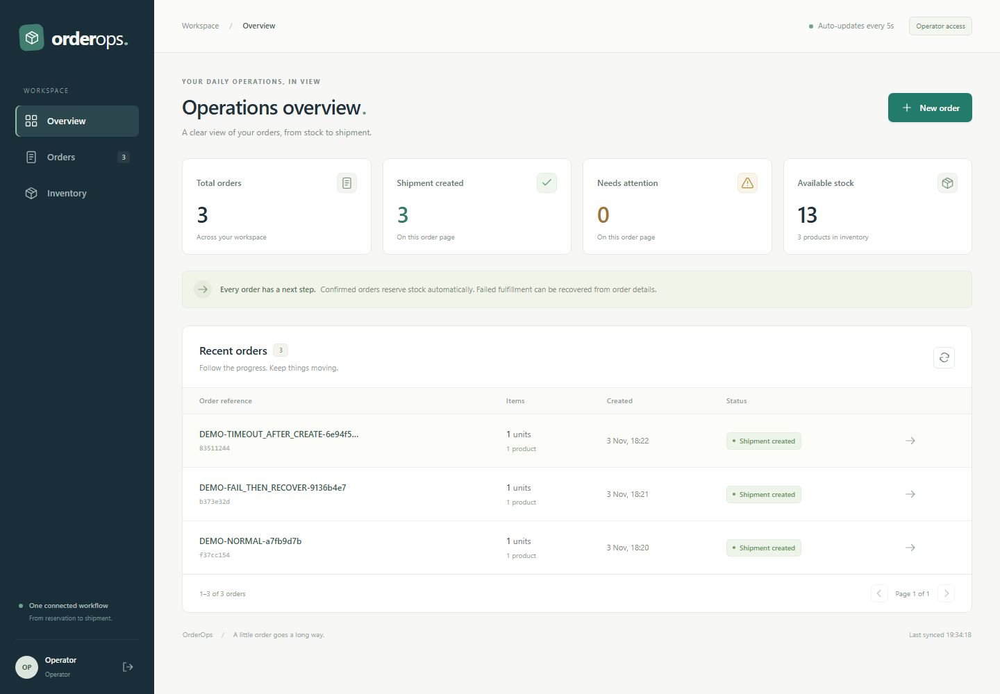
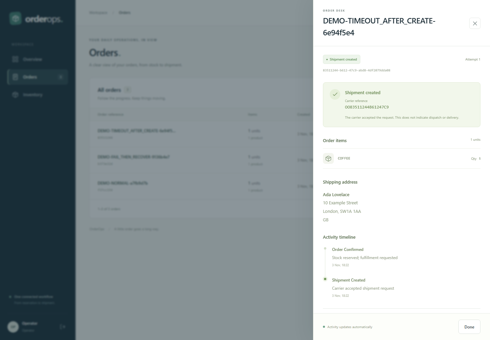
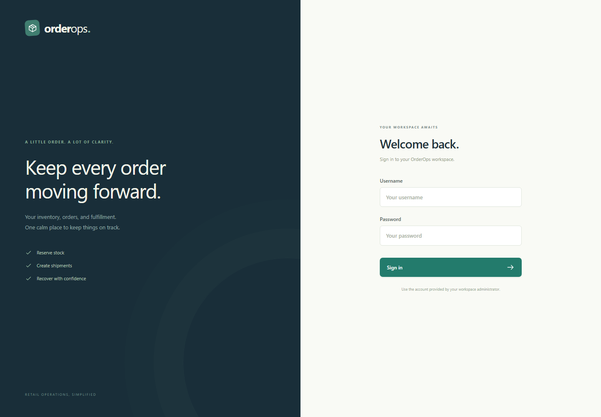
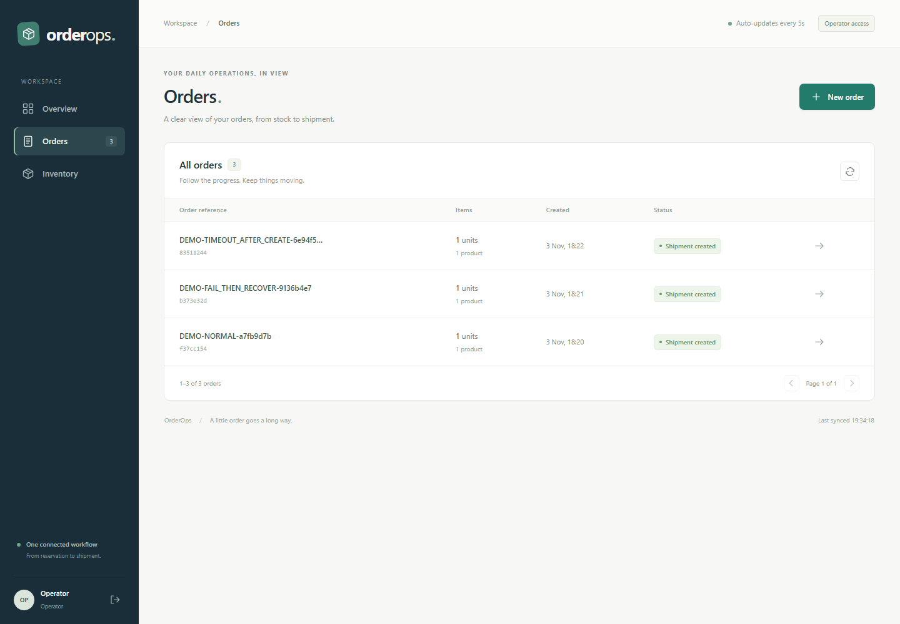
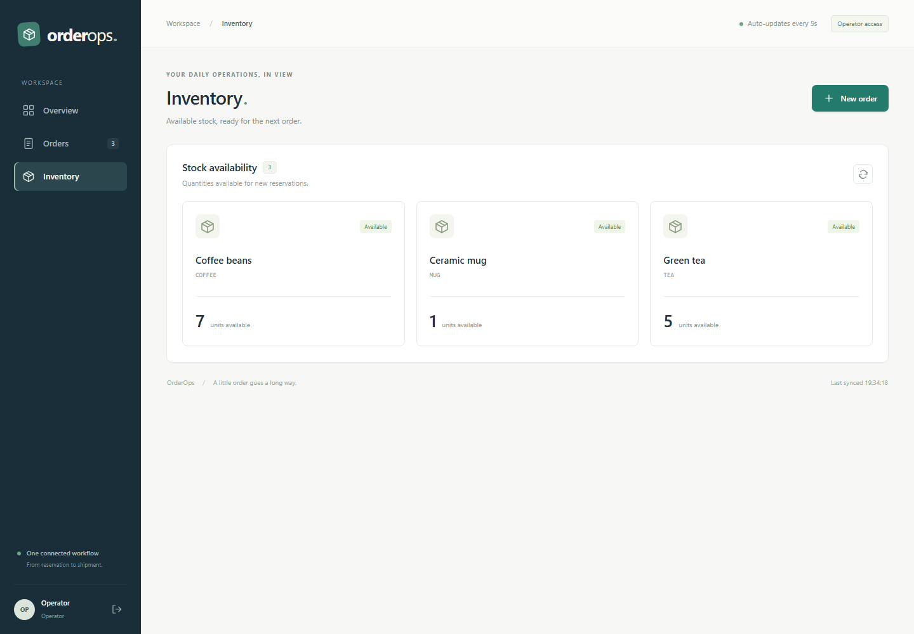
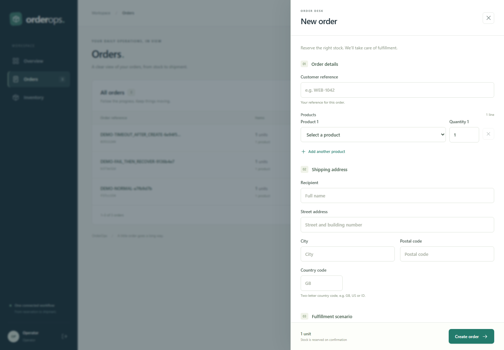
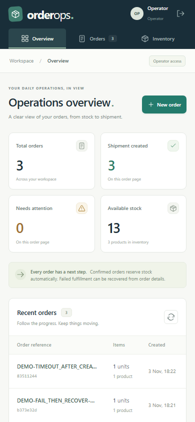

# OrderOps frontend

React + TypeScript operations workspace. Production requests always use the same-origin Order Service API; only the isolated browser tests replace HTTP responses.





This is an independent project and Git repository inside the `orderops` workspace. The Java backend lives in `../backend`. No frontend build or test requires importing backend source.

```text
orderops/
  backend/   # Java services, API contracts, stack orchestration
  frontend/  # This React application, tests, nginx, Docker image
```

## Screens

| Login | Overview | Orders |
| --- | --- | --- |
|  |  |  |

| Inventory | Create order | Mobile overview |
| --- | --- | --- |
|  |  |  |


Regenerate these with `ORDEROPS_SCREENSHOT_URL=http://127.0.0.1:8088 node tools/capture-screens.mjs` against a running stack.

## API documentation

Interactive Swagger UI is served by the backend Order Service at `http://localhost:8080/swagger-ui/index.html` (JSON at `/v3/api-docs`). It documents each endpoint the frontend calls, with sample request and response payloads. The authoritative machine-readable contract remains [`contracts/openapi.yaml`](../backend/contracts/openapi.yaml) in the backend repository.

## Development

Requires Node 22.12 or later. From this directory:

```sh
npm ci
npm run dev
```

Open `http://127.0.0.1:5173`. The loopback Node development server proxies `/api`, `/login`, and `/logout` to `http://127.0.0.1:8080`. Set `ORDEROPS_API_TARGET` before starting it to override the backend target. esbuild bundles the app and watches source changes; refresh the browser to see a rebuild. Restart after editing the HTML template or public assets. Sign in with an account configured for the running Order Service. The local Compose profile supplies demo accounts; production requires configured passwords.

```sh
npm test           # API client, CSRF and request identity tests
npm run typecheck
npm run build
npm run test:ui    # isolated Chromium browser journeys
```

Playwright requires its Chromium browser (`npx playwright install --with-deps chromium` on a new machine). The tests exercise operator recovery, viewer access, uncertain submissions and reloads, pagination, draft-preserving polling, errors, empty results, and mobile navigation. Route replacements are confined to `e2e/dashboard.spec.ts`.

Isolated tests start their own server on port 4173 and never reuse a development server. Close a dev server started from the former `orderops/web` directory before starting development from this project.

The separate real-stack project requires a running Compose stack and seeded inventory. It creates three orders, verifies reservation and identical replay, recovers failed fulfillment, and waits for timeout reconciliation and normal shipment creation. It never replaces a network response.

```sh
# POSIX shell; use $env:NAME='value' in PowerShell
ORDEROPS_E2E_URL=http://127.0.0.1:8088 \
ORDEROPS_E2E_USERNAME=operator \
ORDEROPS_E2E_PASSWORD=operator-local-only \
npm run test:e2e
```

`npm run test:e2e` fails when `ORDEROPS_E2E_URL` is absent; a missing stack is not a passing test. Use an isolated database/stock fixture because these tests reserve real stock. Credentials shown here apply only to the local demo profile.

`Dockerfile` builds the static bundle and serves it through nginx. Its API/login/logout proxy targets `order-service:8080`; `/health` probes nginx. Other paths use the SPA fallback. The TLS edge must set `X-Forwarded-Proto`, which nginx preserves. Publish the container through the provided loopback-bound Compose port or the HTTPS edge.

Build an image independently with `docker build -t orderops-frontend:local .`. To build and run both projects, run this from `../backend` after packaging the Java services and copying `.env.example` to `.env`:

```sh
docker compose --env-file .env -f infra/compose.yaml -f infra/compose.frontend-build.yaml --profile apps up -d --build
```

The backend's base Compose file consumes `ORDEROPS_FRONTEND_IMAGE`; it does not require frontend source. The optional build override defaults to this sibling checkout, or accepts an absolute `ORDEROPS_FRONTEND_PATH` from the shell. Production must select a verified image tag or digest.

This repository's CI runs the audit, client tests, production build, and isolated browser journeys before creating an image archive tagged with the frontend commit SHA. Load that archive using `docker load -i orderops-frontend-image.tar.gz`. The backend repository's manual integration workflow checks out an explicitly selected frontend repository and commit and runs the real-stack journey. Configure `FRONTEND_REPO_TOKEN` there only if private cross-repository checkout requires it.

The authoritative HTTP contract is `contracts/openapi.yaml` in the backend repository. Coordinate contract changes across both projects and verify the selected commit pair before deployment. Vite has been removed; [SECURITY.md](SECURITY.md) records the current audit and development server design.

For a real-stack, captioned five-minute video, set `ORDEROPS_DEMO_URL` and run `npm run demo:record`. This creates three orders using real stock and saves `.cache/demo/orderops-demo.webm` plus verification metadata. Use an isolated demo dataset. See `../backend/docs/DEMO.md` for credentials and the presentation outline.

An uncertain create or recovery response keeps its operation key. The pending create payload and key are retained in session storage, scoped to the signed-in username, and restored after a refresh. Retrying sends the exact saved request. Editing requires an explicit choice to start a separate order; inspect existing orders first. Storage-disabled browsers retain pending operations only until the page is reloaded.

The overview counts for shipment/attention describe the displayed order page. The total order count and inventory quantities come from their respective API responses. Shipment creation means the carrier accepted the request; it does not indicate dispatch or delivery.
